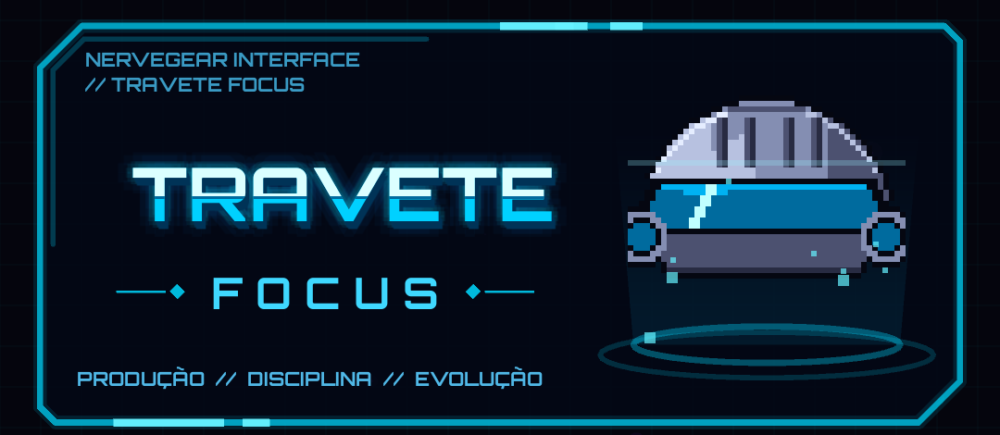
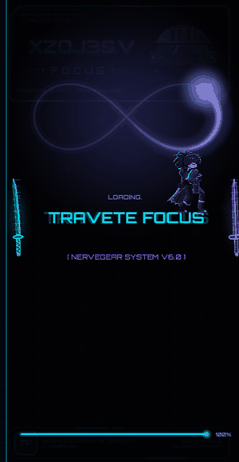
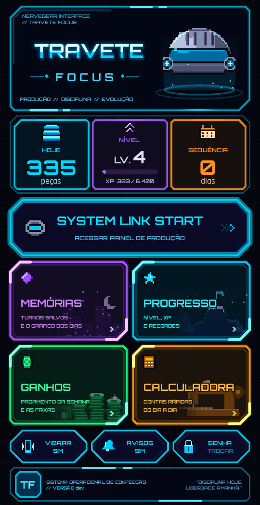
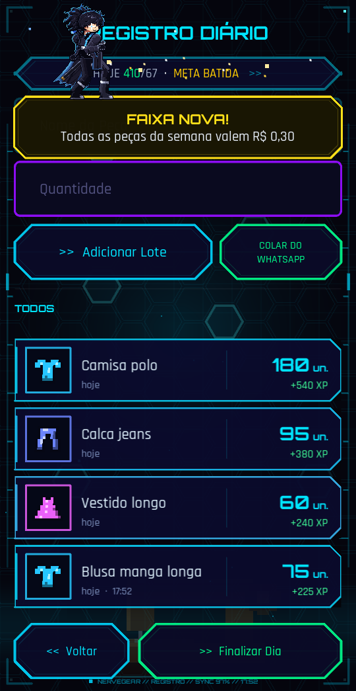
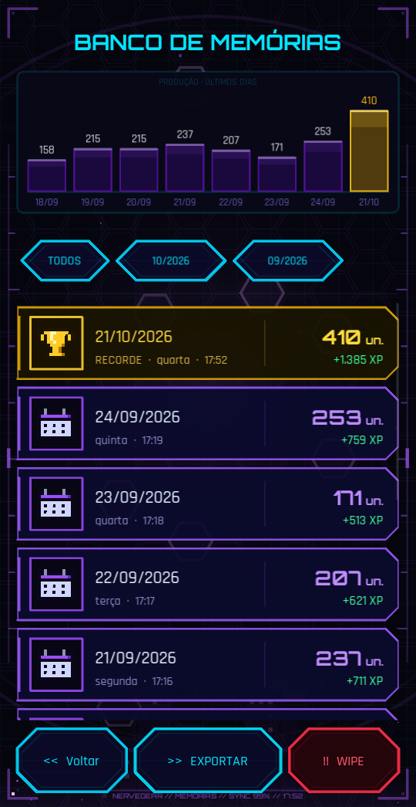
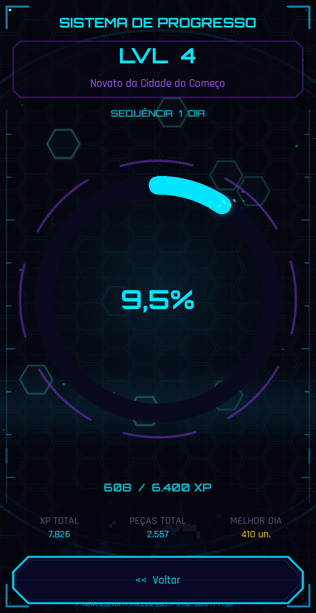
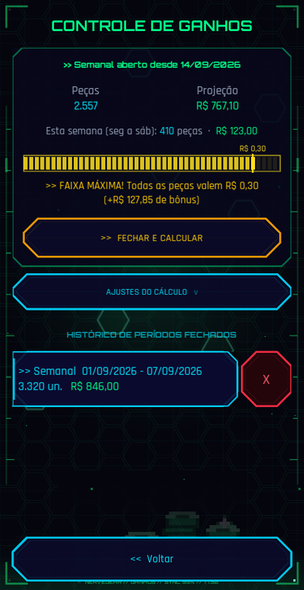
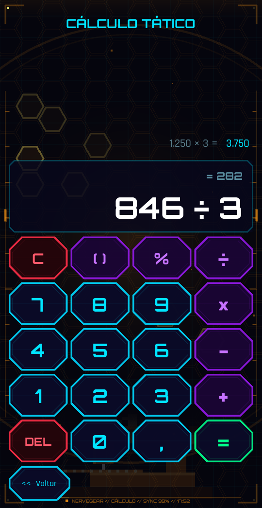

  

  
  
  
  

  <b>Um app para quem trabalha por peça, que transforma a produção do dia num pequeno RPG.</b> 
  Lance os lotes, acompanhe a meta da semana e as faixas de pagamento, ganhe XP e suba de nível.

---

## Sobre o projeto

O **TraveteFocus** nasceu de uma necessidade real: quem trabalha com
**travete/costura recebendo por peça** precisa saber, a cada dia, quanto já
produziu, quanto falta para a meta da semana e quanto vai receber — e a
semana tem **faixas de pagamento** (quanto mais peças, mais vale cada uma).

Em vez de anotar num caderno, o app faz as contas e deixa o trabalho com cara
de jogo: cada lote vira XP, os dias seguidos viram uma sequência e o **Yoru**,
o espadachim do app, comemora as conquistas. Tudo num visual **HUD futurista**
(inspirado em *Sword Art Online*), animado e feito para rodar liso, a
**60 quadros por segundo**, num celular comum.

  

## Como este app é feito

> **Sou o autor e não tenho formação nem experiência em programação.**
> O TraveteFocus é desenvolvido **com inteligência artificial** (o assistente
> **Claude**, da Anthropic): eu descrevo o que preciso, decido o visual e o
> comportamento, **testo cada versão no meu próprio celular, no trabalho de
> verdade**, e reviso com cuidado o que muda antes de publicar.

Na prática, cada versão passa por:

- **Uma ideia ou um problema real** que eu encontro usando o app no dia a dia;
- **exemplos visuais** para eu escolher antes de qualquer mudança grande;
- uma **bateria de testes automáticos** no tamanho exato do meu celular
  (toques de verdade, trocas de tela, cenas animadas, avisos, fluidez quadro a
  quadro e as contas de metas e pagamento);
- **o meu teste no celular**, e só então a publicação.

Por isso o código pode ter decisões que um programador experiente faria de
outro jeito. Sugestões e correções são bem-vindas pelas *Issues*.

## Telas

| Menu | Registro | Memórias |
|:---:|:---:|:---:|
|  |  |  |
| **Progresso** | **Ganhos** | **Calculadora** |
|  |  |  |

## O que o app faz

| | |
|---|---|
| **Registro diário** | Lança cada lote (peça + quantidade, com ícone pelo tipo de roupa) ou **cola a mensagem do WhatsApp** e o app separa os lotes sozinho. Mostra quanto saiu hoje e a meta do dia. |
| **Memórias** | Cada turno salvo (dia, peças, XP), o recorde em destaque, gráfico dos últimos dias e filtro por mês. Exporta e manda pelo WhatsApp. |
| **Progresso** | Nível, XP, título, sequência de dias trabalhados e recordes. |
| **Ganhos** | O período aberto, a projeção em R$ e as **faixas de pagamento** da semana (ex.: R$ 0,25 → 0,27 a partir de 2.500 peças → 0,30 a partir de 3.000): quanto falta para a próxima e quanto por dia, com o sábado como **previsão** de meio período. |
| **Calculadora** | Contas rápidas com histórico. |
| **Avisos** | Cards no visual do app, com o Yoru, uma fala dele e a barra de progresso: lembrete para lançar (11h), sequência em risco (15h), meta do dia (16h), fechamento do dia (20h), faixa nova na hora em que a semana sobe de faixa, faixa ao alcance e resumo da semana (sábado). O botão **AVISOS** mostra o que pode estar bloqueando e tem um **teste**. |
| **Senha** | PIN guardado só como impressão digital (PBKDF2 com sal) no celular; errar 3 vezes bloqueia por um tempo crescente. |

## Instalar

1. Baixe o `.apk` mais recente em **[Releases](../../releases/latest)**
   (cada atualização gera um APK novo automaticamente).
2. Antes de atualizar, **exporte um backup** (Memórias → EXPORTAR).
3. Instale **por cima** do app antigo. **Nunca desinstale**: os dados ficam só
   no celular e iriam junto.

> **Privacidade:** nenhum dado sai do celular — produção, turnos, ganhos e a
> senha ficam no armazenamento do app. Este repositório contém só o código.
> Troque a senha padrão no primeiro uso (botão **SENHA** do menu).

## Como o projeto é organizado

<b>Ver o mapa dos arquivos</b>

| Arquivo / pasta | O que é |
|---|---|
| `main.py` | Início do app: dados, telas, menu e avisos |
| `interface.kv` | O layout de todas as telas (Kivy) |
| `telas/` | Uma tela por arquivo: registro, memórias, progresso, ganhos, calculadora e a abertura (senha) |
| `menu_hud.py` | O menu HUD (cabeçalho com o capacete NerveGear, painel, cartões) e o fundo animado das telas |
| `efeitos.py`, `animacoes_ui.py` | Botões, cartões, gráficos, barras, ícones de pixel e as animações da interface |
| `helpers.py` | Avisos (popups), o teclado do app e as trocas de tela |
| `metas.py` | As contas: semana, faixas de pagamento e meta do dia |
| `lembretes.py` + `java/` + `res_notif/`, `res_yoru/`, `res_layout/` | Avisos na barra do celular (AlarmManager + recebedor em Java que monta o card) |
| `kirito.py`, `cenas.py`, `yoru_*`, `bankai/` | O Yoru: desenho em pixel art, poses e as cenas animadas |
| `chefe*.py`, `chefe/`, `espadachim.py`, `infinito.py` | A abertura (a luta contra o chefe) e os efeitos de espada |
| `notificacoes.py`, `som.py`, `tatil.py` | LEVEL UP, sons e vibração |
| `importar_zap.py`, `exportar.py`, `seguranca.py` | WhatsApp, exportação e a senha |
| `sons/`, `*.ttf`, `*.png` | Sons, fontes e ícones (créditos em `sons/CREDITOS.txt` e `OFL-*.txt`) |
| `dev/` | Ferramentas de desenvolvimento e testes (não vão para o APK) — veja `dev/LEIA-ME.txt` |
| `docs/` | Imagens deste README (não vão para o APK) |
| `.github/` | O build do APK no GitHub Actions |

## Tecnologia

- **Python + Kivy 2.3**, empacotado para Android com **buildozer /
  python-for-android**; os avisos usam um pequeno recebedor em **Java**.
- O APK é gerado e publicado pelo **GitHub Actions** a cada atualização,
  assinado com uma chave guardada nos *Secrets* do repositório. A versão vem
  do arquivo `VERSAO`.
- Testes no PC (Git Bash, dentro desta pasta): `bash dev/bateria_curta.sh`.

---

  Feito com IA e com muito cuidado por quem usa o app todo dia no trabalho. 🧵⚔️

